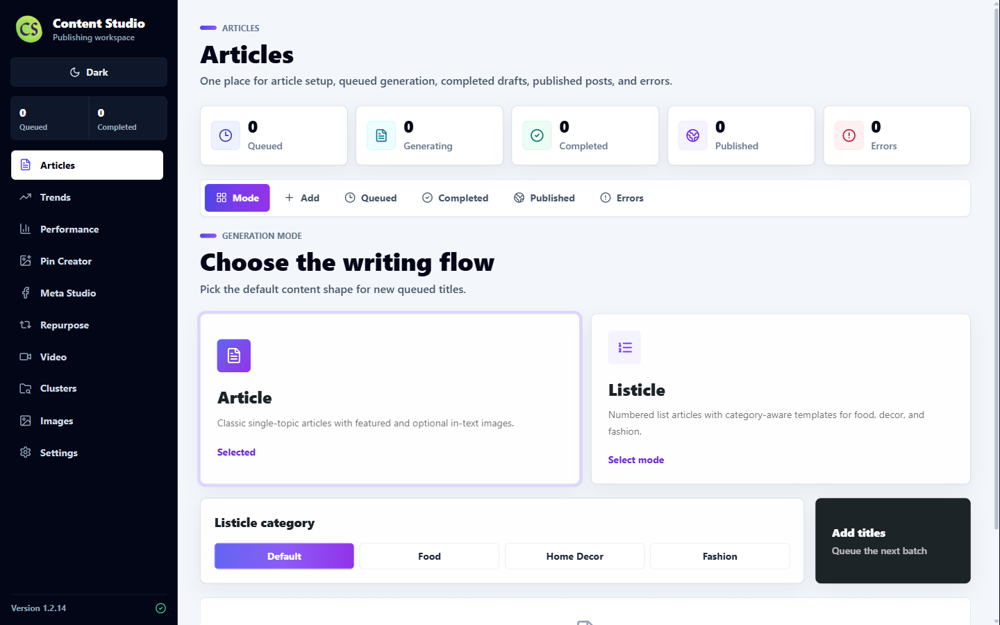

# Content Studio

<p align="center">
  
</p>

<p align="center">
  An AI-assisted desktop publishing workspace for turning recipe ideas into useful articles, WordPress posts, Pinterest pins, social campaigns, and measurable content workflows.
</p>

<p align="center">
  <a href="https://github.com/mahdibouizmoune/content-studio/actions/workflows/ci.yml"></a>
  <a href="https://github.com/mahdibouizmoune/content-studio/releases/latest"></a>
  
  
</p>



## What It Does

Content Studio keeps the complete publishing workflow in one desktop application:

1. Research content opportunities and plan topic clusters.
2. Generate reader-first recipe articles with controlled length and quality checks.
3. Create, optimize, and reuse article images.
4. Publish to WordPress with categories, Rank Math fields, Recipe JSON-LD, and WebP media.
5. Create Pinterest pins with duplicate protection, board matching, UTM tracking, and scheduling CSVs.
6. Produce dedicated Facebook and Instagram content plus editable GoHighLevel CSV exports.
7. Discover relevant Impact and Amazon affiliate opportunities and place verified links responsibly.
8. Monitor content performance, SEO quality, and opportunities for updates.

## Product Highlights

- **Unified article workflow:** queued, generating, completed, published, and error states in one workspace.
- **Quality-aware generation:** recipe completeness, item-count validation, article-length controls, editorial review, and repair passes.
- **WordPress publishing:** category synchronization, automatic category selection, internal linking, Rank Math metadata, featured media, and publish tracking.
- **Recipe publishing:** recipe cards, Recipe Schema JSON-LD, measurable ingredients, actionable instructions, and SEO preflight checks.
- **Pinterest production:** pin generation, realistic food-image prompting, configurable styles and text placement, board matching, duplicate protection, and bulk CSV editing.
- **Social content:** platform-specific Facebook and Instagram content, image reuse, scheduling data, and GoHighLevel exports.
- **Video studio:** Replicate-powered video generation with selectable models, duration, and aspect ratio.
- **Performance intelligence:** trends research, Pinterest evidence, content clusters, cannibalization checks, and update opportunities.
- **Affiliate workflow:** Impact and Amazon support with encrypted credentials, tracked URLs, disclosure handling, and match-quality safeguards.
- **Desktop security:** Electron sandboxing, context isolation, strict CSP, encrypted secrets through `safeStorage`, remote-media validation, and bounded network retries.

## Architecture

```text
React + Vite renderer
        |
Unified context-isolated preload
        |
Electron main process
        |
Replicate | WordPress REST API | ImgBB | Impact | Amazon | GHL
```

The renderer never receives Node.js access. Privileged operations are exposed through a single allowlisted preload API. User credentials are encrypted locally and are never committed to this repository.

## Tech Stack

- Electron 40
- React 18
- Vite 7
- Tailwind CSS
- Replicate API
- WordPress REST API
- Sharp for WebP optimization
- Electron Store and Electron `safeStorage`
- Node.js built-in test runner

## Local Development

### Requirements

- Node.js 20.19 or newer
- npm
- A Replicate API token for AI generation
- Optional WordPress, ImgBB, Impact, Amazon, and GoHighLevel credentials

### Install and Run

```bash
npm install
npm run dev
```

### Test and Build

```bash
npm test
npm run build
npm run dist:win
```

Run `npm run dist:mac` on macOS to build the DMG.

## Configuration

All service credentials are entered inside the application Settings screen. Secrets are encrypted with the operating system credential service before they are stored. No `.env` file is required for normal desktop use.

## Quality and Safety

The reliability suite covers publishing state, generation recovery, recipe validation, affiliate tracking, UTM handling, image security, Pinterest prompt quality, queue integrity, media optimization, and performance intelligence.

Before opening a pull request:

```bash
npm test
npm run build
```

## Download

Windows installers are available from [GitHub Releases](https://github.com/mahdibouizmoune/content-studio/releases/latest).

## License

Copyright © 2026 Mahdi Bouizmoune. All rights reserved.

The source is published for portfolio review and educational inspection. Copying, redistribution, resale, or creation of derivative commercial products is not permitted without written authorization. See [LICENSE](LICENSE).
