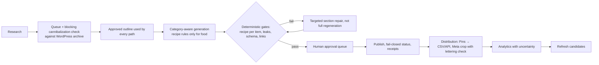

# 03 — Workflow Audit

## Current main workflow

## Failure points found

| Stage | Failure | Status |
|---|---|---|
| Bulk publish | Quality blockers ignored | Fixed: blocked articles count as "needs review" with reasons |
| Recipe readiness | Recipes 2–N of complete collections not gated | Fixed for `complete-recipes` collections |
| Card repair | Repaired AI text not re-checked for prompt leaks | Fixed |
| Payload | Unknown status → public | Fixed: fails closed to draft |
| Generation | Non-food listicles get recipe rules and paid card repair | Open (needs paid testing) |
| Generation | Long lengths (6,500+ words) exceed max_tokens and trigger 3 paid retries | Open |
| Featured image | Deferred image still publishes with no featured media | Open (behaviour change) |
| Publish receipt | Unknown outcome blocks forever; no clear action | Open |
| GHL refresh | Receipts beyond 200 erased (duplicate risk) | Fixed |
| GHL dedupe | Key changes when schedule/image URL changes | Open |
| Video | Download failure lost paid result | Fixed |
| Pinterest API tick | Board re-sync every 30 s | Fixed (earlier this session) |

## Improved workflow (proposed)

The lifecycle (Idea → Draft → Validating → Needs revision → Approved → Scheduled → Publishing → Published → Analyzing → Refresh) mostly exists as `workflowStatus`/`queueStatus` values; the gaps are the blocking gates above, not a new orchestrator.
